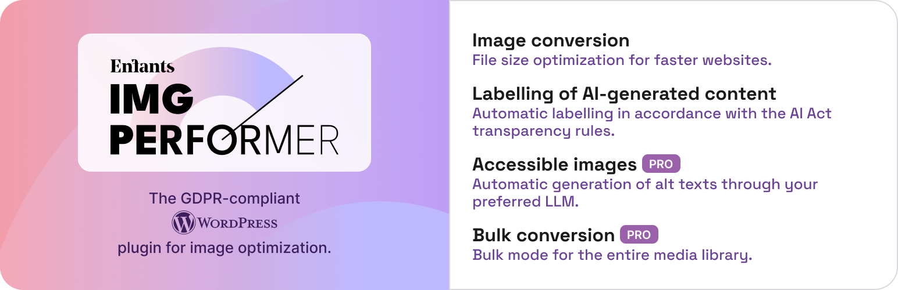
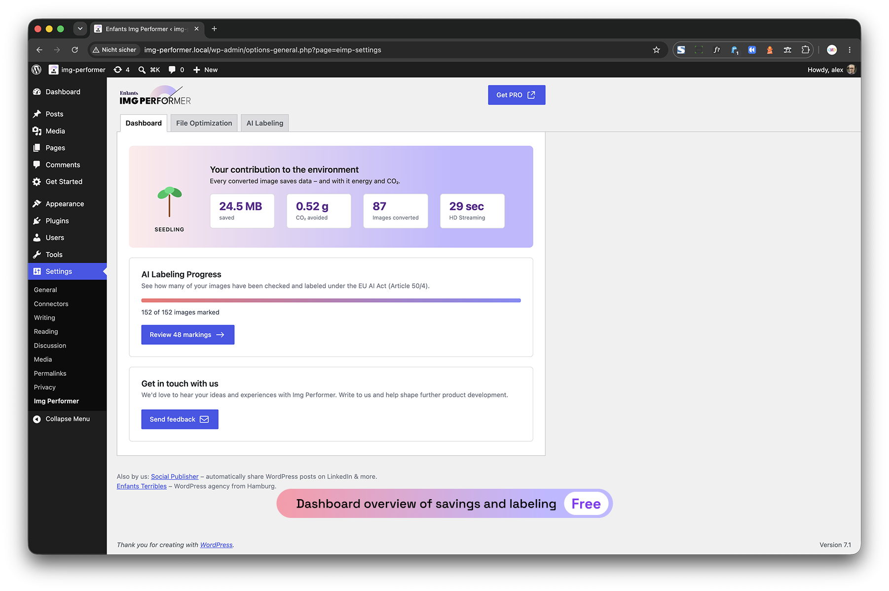
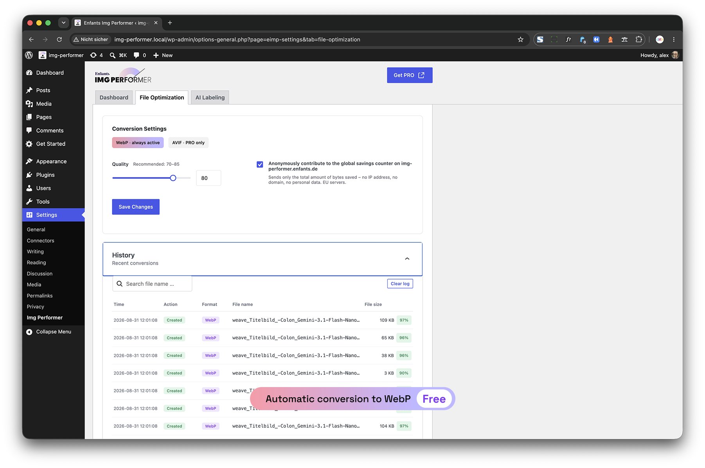
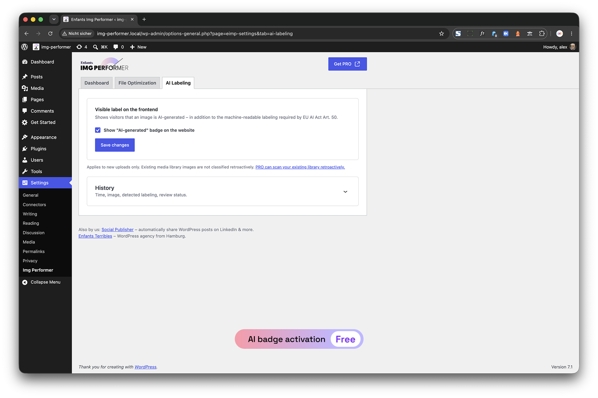
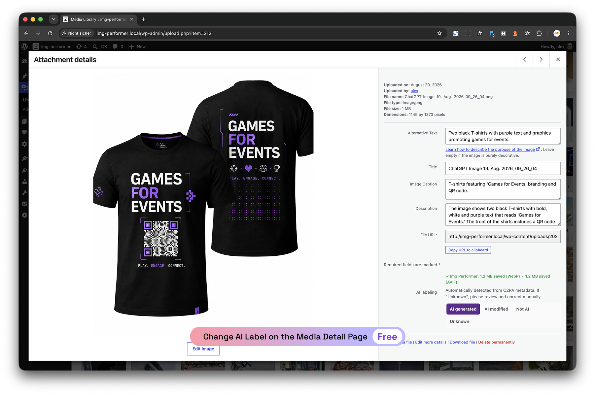
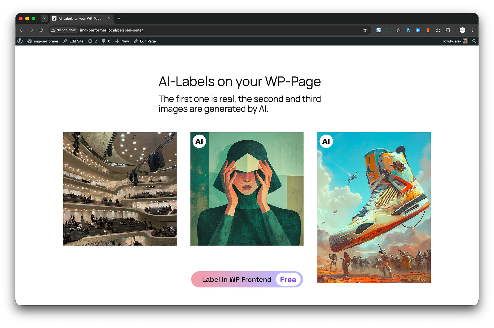
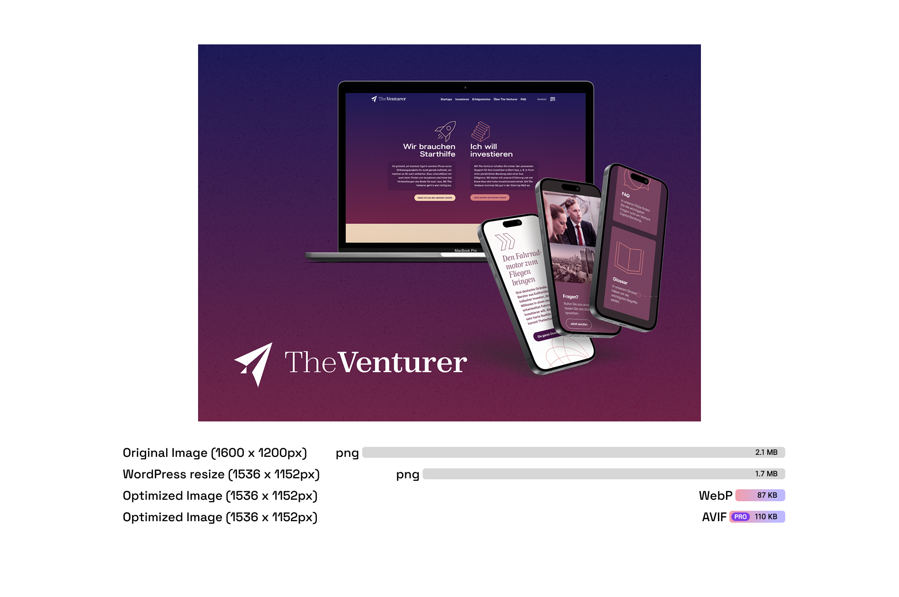
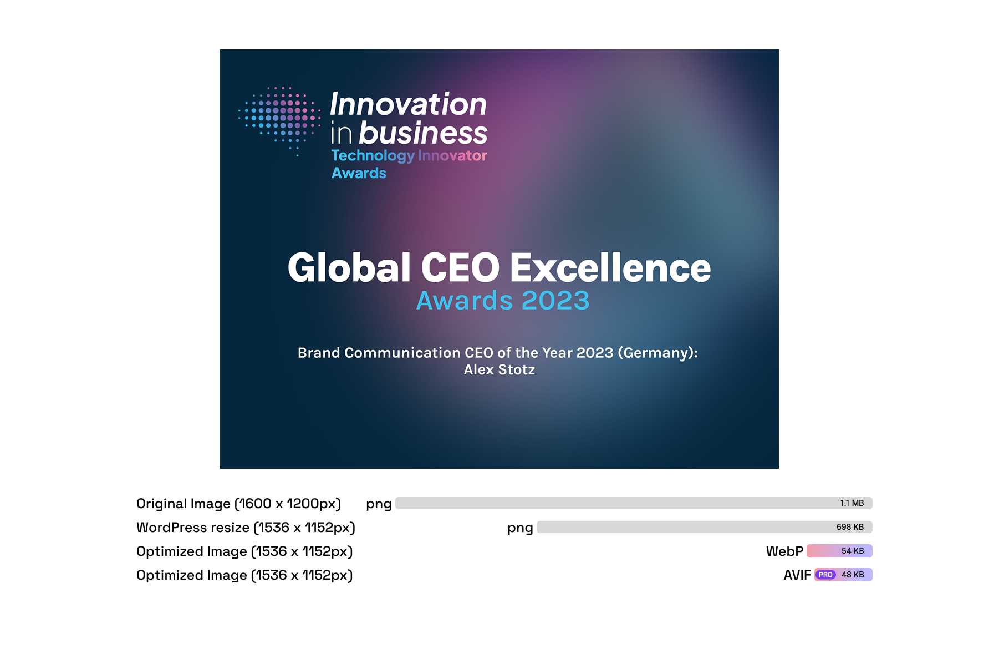
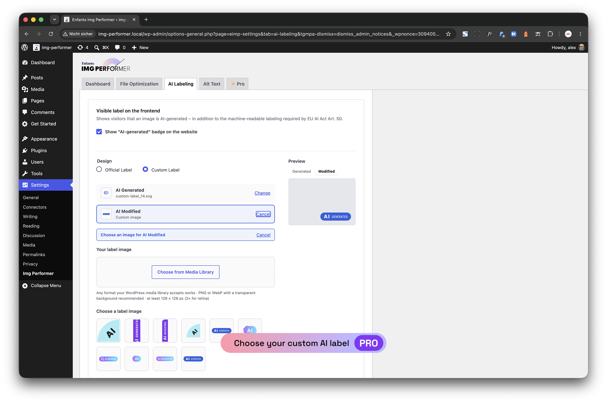

  🇩🇪 Deutsch · <a href="README.en.md">🇬🇧 English</a>

  

<h1 align="center">IMG Performer</h1>

  <strong>WebP/AVIF-Konvertierung und KI-Bildkennzeichnung nach EU AI Act für WordPress – direkt auf Ihrem eigenen Server.</strong> 
  Keine Cloud, kein Konto, kein Monatskontingent.

  
  
  
  
  
  

  <a href="https://wordpress.org/plugins/enfants-img-performer/"><strong>Download</strong></a> ·
  <a href="https://img-performer.enfants.de/">Website</a> ·
  <a href="https://img-performer.enfants.de/#pricing">Preise</a> ·
  <a href="https://wordpress.org/plugins/enfants-img-performer/#developers">Changelog</a> ·
  <a href="https://wordpress.org/support/plugin/enfants-img-performer/">Support</a>

---

## Warum noch ein Bild-Plugin?

Viele Bildoptimierer laden Ihre Dateien zu einem Drittanbieter hoch und begrenzen Sie pro Monat. **IMG Performer konvertiert lokal** mit der PHP-Bibliothek GD. Für die Konvertierung und die Kennzeichnung KI-generierter Bilder verlassen Ihre Bilder Ihren Server nicht – das ist für Websites in Deutschland, Österreich und der Schweiz ein klarer Vorteil bei der DSGVO.

Seit dem **2. August 2026** gilt Artikel 50 der EU-KI-Verordnung (EU AI Act). WordPress entfernt beim Erzeugen der Vorschaubilder eingebettete Herkunftsangaben. Für die Kennzeichnung KI-generierter Bilder braucht es deshalb eine eigene Lösung. Das Plugin übernimmt das direkt beim Upload.

## Funktionen

### Konvertierung

- Wandelt JPEG- und PNG-Uploads automatisch in **WebP** um – unbegrenzt und kostenlos
- Konvertiert alle registrierten Bildgrößen (Thumbnail, Medium, Large, eigene Größen)
- Schreibt `src`, `srcset`, `href` (Lightbox) und Lazy-Load-Attribute im Frontend um
- Löscht die WebP-Dateien, wenn das Original gelöscht wird
- Qualität einstellbar von 1 bis 100, Aktivitätsprotokoll für jede Konvertierung
- Optionaler CO₂-Spar-Zähler (anonyme Statistik nur per Opt-in)

### KI-Bildkennzeichnung nach EU AI Act (Art. 50)

- Erkennt KI-Herkunft in neuen Uploads (eingebettete Metadaten wie C2PA-Manifeste, sofern vorhanden)
- Schreibt eine eigene, hosting-unabhängige Kennzeichnung in das Original und jede erzeugte Bildgröße – ohne Imagick
- Zeigt im Frontend ein sichtbares **Badge „KI-generiert"** an, abschaltbar
- Automatische Einstufung in der Mediathek mit einem Klick korrigieren
- Statusspalten für KI-Kennzeichnung und Alt-Text sowie ein Filter für noch ungeprüfte Bilder
- Erzeugt für KI-gekennzeichnete Beitragsbilder ein `og:image` (1200×630) mit Kennzeichnung

### PRO

- **AVIF-Konvertierung**, meist kleiner als WebP
- **Bulk-Konvertierung** der gesamten Mediathek
- **KI-Alt-Text-Generator** (WCAG 2.1 AA) mit Ihrem eigenen API-Schlüssel: Mistral, Claude, OpenAI oder jeder OpenAI-kompatible Endpunkt, auch selbst gehostet
- Optionaler Hinweis im Alt-Text von Bildern, die als KI-generiert eingestuft sind

## Screenshots

<table>
  <tr>
    <td width="50%"> Einstellungen und CO₂-Zähler</td>
    <td width="50%"> Einstellungen zur KI-Kennzeichnung</td>
  </tr>
  <tr>
    <td width="50%"> Mediathek mit Statusspalten und Filter für ungeprüfte Bilder</td>
    <td width="50%"> Sichtbares Badge im Frontend</td>
  </tr>
  <tr>
    <td width="50%"> Original-PNG 2,1 MB → WebP 87 KB → AVIF 110 KB (PRO)</td>
    <td width="50%"> JPEG 329 KB → WebP 119 KB → AVIF 142 KB (PRO)</td>
  </tr>
  <tr>
    <td width="50%"> PRO: AVIF, Bulk und KI-Alt-Texte</td>
    <td width="50%"> PRO: erzeugter Alt-Text, Bildunterschrift und Beschreibung</td>
  </tr>
</table>

## Installation

1. Im WordPress-Backend unter **Plugins → Neu hinzufügen** nach **IMG Performer** suchen, oder [auf WordPress.org herunterladen](https://de.wordpress.org/plugins/enfants-img-performer/).
2. Plugin aktivieren.
3. Unter **Einstellungen → IMG Performer** die Qualität festlegen.

**Voraussetzungen:** WordPress 6.0+, PHP 7.4+, GD mit WebP-Unterstützung (`imagewebp`). AVIF (PRO) braucht PHP 8.1+ mit AVIF-Unterstützung in GD oder Imagick mit AVIF. Ohne diese Unterstützung wird WebP ausgeliefert.

## Kostenlos oder PRO

| | Kostenlos | PRO |
|---|:---:|:---:|
| WebP-Konvertierung, unbegrenzt | ✅ | ✅ |
| KI-Kennzeichnung nach EU AI Act und Badge | ✅ | ✅ |
| `og:image` mit KI-Kennzeichnung | ✅ | ✅ |
| AVIF-Konvertierung | | ✅ |
| Bulk-Konvertierung | | ✅ |
| KI-Alt-Text-Generator (eigener API-Schlüssel) | | ✅ |

## Datenschutz (DSGVO)

Konvertierung und Kennzeichnung KI-generierter Bilder laufen vollständig auf Ihrem Server. Die kostenlose Version braucht keinen API-Schlüssel und sendet weder Bilddaten noch personenbezogene Daten an externe Dienste. Die einzige optionale externe Verbindung ist die CO₂-Statistik per Opt-in. Sie übermittelt nur die insgesamt gesparten Bytes und eine zufällige, anonyme Site-ID – keine Domain, keine IP-Adresse.

Der KI-Alt-Text in PRO funktioniert anders: Das Bild geht an den KI-Anbieter, dessen API-Schlüssel Sie eintragen. Dafür brauchen Sie einen Auftragsverarbeitungsvertrag (AVV) mit diesem Anbieter. Wir empfehlen Mistral (EU-Unternehmen, EU-Server).

## Quellcode und Lizenz

Das kostenlose Plugin ist Open Source unter **GPL-2.0 oder neuer** und wird über [WordPress.org](https://de.wordpress.org/plugins/enfants-img-performer/) verteilt. Der Quellcode liegt nicht in diesem Repository. Es enthält nur README, Screenshots und Links. PRO ist ein eigenes, kommerzielles Plugin.

## Links und Support

- Website: [img-performer.enfants.de](https://img-performer.enfants.de/)
- Support-Forum: [wordpress.org/support/plugin/enfants-img-performer](https://wordpress.org/support/plugin/enfants-img-performer/)
- Entwickelt von [enfants terribles](https://enfants.de), Hamburg
